**Student:** `<name, BITS ID>` | **Repository:** `<GitHub URL>` | **Video:** `<link>` | **API / access:** `<URL or "localhost, see section 2">`

# 1. Introduction

**Problem.** Predict whether a patient has heart disease from 13 routine clinical attributes and serve the model as a containerised, monitored REST API on Kubernetes.

**Data.** UCI Heart Disease, Cleveland subset (303 patients, 13 features, original 0-4 severity label binarised to presence/absence).

**Scope.** Acquisition and EDA, feature engineering, two tuned models, MLflow tracking, packaging, unit tests, GitHub Actions CI/CD, Docker, Kubernetes deployment, Prometheus/Grafana monitoring.

**Headline result.** Logistic Regression was selected (nested-CV ROC-AUC 0.898; 20% hold-out ROC-AUC 0.965, recall 0.93).

# 2. Setup and installation

```bash
python -m venv .venv && source .venv/bin/activate     # Windows: .venv\Scripts\activate
pip install -r requirements-dev.txt
python scripts/download_data.py          # fetch UCI file, write data/processed/heart_clean.csv
python -m src.heart.eda                  # figures -> reports/figures
python -m src.heart.train                # MLflow runs -> ./mlruns, model -> models/
mlflow ui                                # http://127.0.0.1:5000
flake8 src api tests scripts && pytest -v
docker build -t heart-api:latest . && docker run -p 8000:8000 heart-api:latest
curl -X POST localhost:8000/predict -H "Content-Type: application/json" -d @scripts/sample_request.json
```

If UCI is unreachable, the file `processed.cleveland.data` can be placed manually in `data/raw/`. Dependencies are split into `requirements.txt` (training), `requirements-serve.txt` (slim serving image) and `requirements-dev.txt` (adds pytest and flake8).

# 3. Data acquisition and EDA

**Acquisition and cleaning** (`scripts/download_data.py`, `src/heart/data.py`): `?` is parsed as missing; duplicates are dropped; the 0-4 label `num` is binarised (`>0` means disease). Missing values (`ca`: 4, `thal`: 2; six rows in total) are *not* filled during cleaning. They are imputed inside the model pipeline so that statistics come only from training folds (no leakage). A schema check (`validate_schema`) guards column presence.

**Class balance.** 164 healthy (54.1%) vs 139 diseased (45.9%): near-balanced, so accuracy is meaningful. Recall is still tracked because a false negative (missed disease) is the costly error.

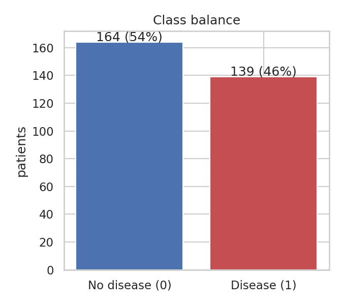{width=45%}

**Distributions.** Diseased patients are older (mean 56.6 vs 52.6), reach a lower maximum heart rate (139 vs 158), and have much higher ST depression `oldpeak` (1.57 vs 0.59). Cholesterol differs little (251 vs 243).

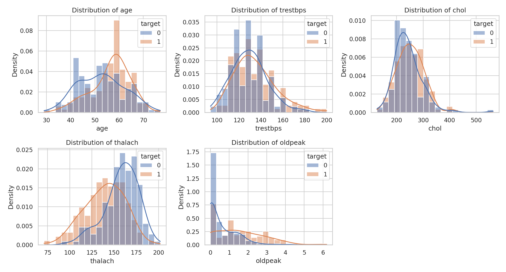

**Outliers.** IQR rule flags 5 values in `chol`, 5 in `oldpeak` and 9 in `trestbps`. They are clinically plausible (e.g. cholesterol 564 mg/dl), so they are kept; scaling and a regularised model limit their influence.

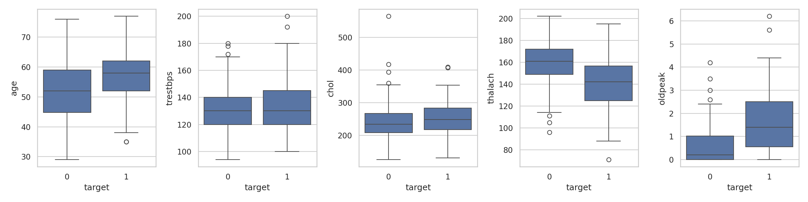{width=85%}

**Correlation with target.** Strongest: `thal` (0.53), `ca` (0.46), `exang` (0.43), `oldpeak` (0.43), `thalach` (-0.42), `cp` (0.41), `slope` (0.34). Weak: `chol` (0.09) and `fbs` (0.03). No pair of predictors is so strongly collinear that it needs removal.

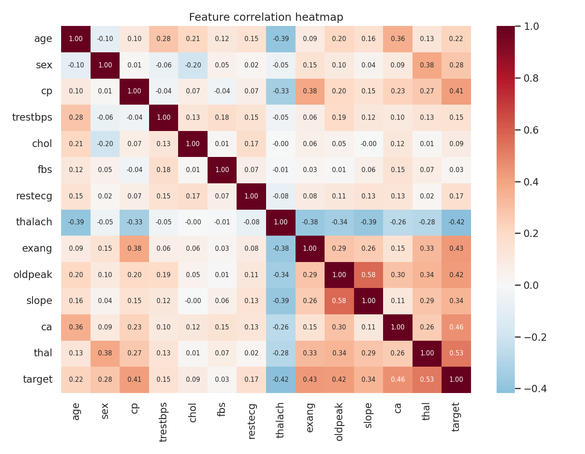{width=80%}

**Categorical effects.** Disease rate is 77% with exercise-induced angina vs 31% without; 55% in males vs 26% in females; and 73% for asymptomatic chest pain (`cp`=4) vs 18-30% for other types.

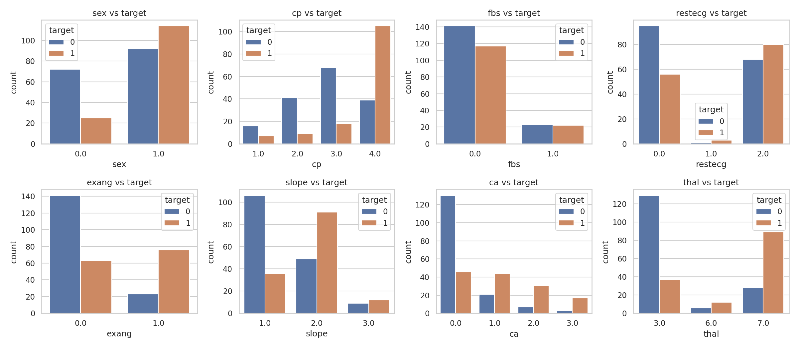

# 4. Feature engineering and modelling choices

**Preprocessing** (`src/heart/features.py`, one `ColumnTransformer`):

| Group | Columns | Steps |
|---|---|---|
| Numeric | age, trestbps, chol, thalach, oldpeak | median imputation, standard scaling |
| Categorical | sex, cp, fbs, restecg, exang, slope, ca, thal | most-frequent imputation, one-hot (`handle_unknown="ignore"`) |

`handle_unknown="ignore"` means an unseen code at serving time cannot crash the API. Treating `ca`, `thal`, `cp`, `slope` as categorical avoids imposing a false ordering on codes.

**Models.** Logistic Regression (interpretable, strong baseline for small tabular data) and Random Forest (captures non-linearity and interactions).

**Tuning and evaluation.** An 80/20 stratified split (seed 42) holds out 61 patients for the final test. On the 80% training portion, `GridSearchCV` (3-fold, ROC-AUC) is nested inside 5-fold stratified cross-validation, so reported CV metrics are not inflated by tuning. Grids: LR `C`; RF `n_estimators`, `max_depth`, `min_samples_leaf`. Metrics: accuracy, precision, recall, F1, ROC-AUC.

| Model (best params) | CV acc | CV prec | CV recall | CV ROC-AUC | Test acc | Test recall | Test ROC-AUC |
|---|---|---|---|---|---|---|---|
| Logistic Regression (C=0.1) | 0.831 | 0.859 | 0.765 | 0.898 | 0.885 | 0.929 | 0.965 |
| Random Forest (depth 3, leaf 3, 100 trees) | 0.818 | 0.830 | 0.764 | 0.897 | 0.836 | 0.857 | 0.947 |

**Selection.** Rule: highest mean nested-CV ROC-AUC. Logistic Regression wins, only marginally on CV (0.898 vs 0.897) but with lower fold variance (ROC-AUC std 0.012 vs 0.028) and better hold-out results. Tuning chose strong regularisation (C=0.1) for LR and shallow trees for RF, both signs that with 303 rows the data supports only simple models. A simple linear model is also easier to explain clinically.

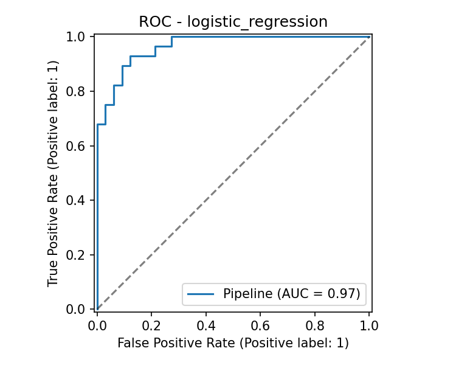{width=45%}
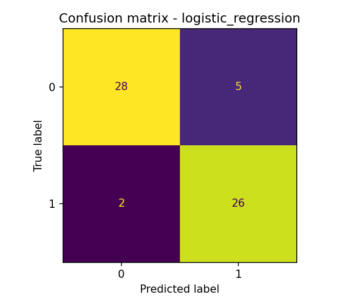{width=45%}

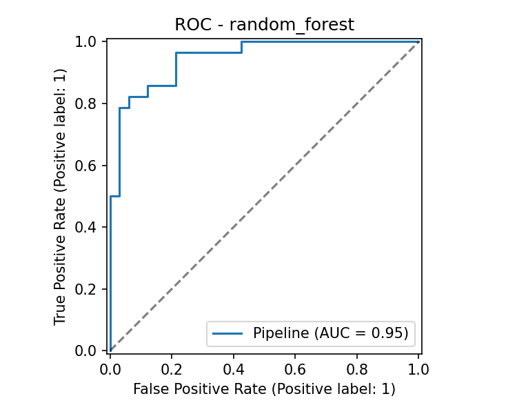{width=45%}
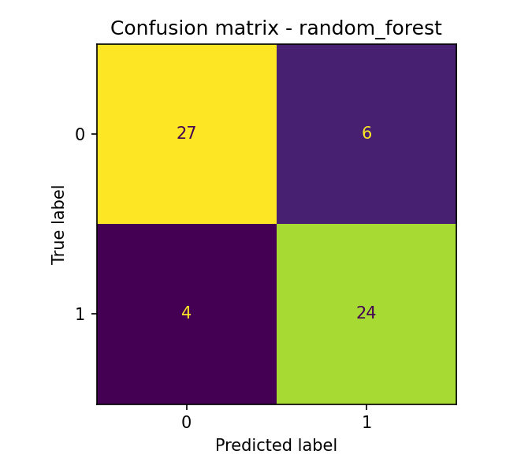{width=45%}

**Caveat.** With 61 test rows, one patient changes accuracy by 1.6 points; the test figures carry wide uncertainty, so the CV numbers are the more reliable comparison.

# 5. Experiment tracking summary

MLflow (local file store `mlruns/`, experiment `heart-disease`) records one parent run per training session and one nested run per model. Logged per run: hyper-parameters, seed, library versions, nested-CV metrics (mean and std), hold-out metrics, ROC and confusion-matrix plots, and the fitted pipeline with its input signature. `Tracker` (`src/heart/tracking.py`) wraps MLflow so training also works with `--no-mlflow` (used in unit tests).

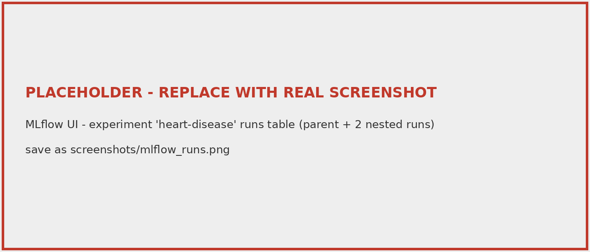

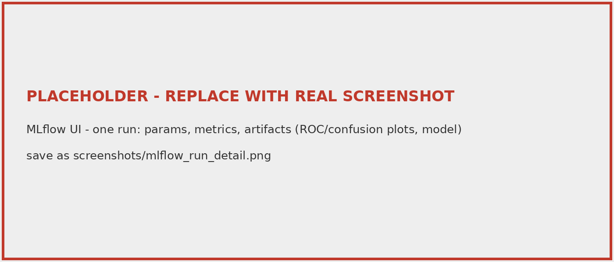

**Observations.** Both models reach almost identical CV ROC-AUC, but RF shows roughly twice the fold-to-fold variance. Larger RF depth was not selected by the grid, consistent with overfitting on 242 training rows. Tracking made this comparison reproducible: every number above can be traced to a run, parameters and seed.

# 6. Model packaging and reproducibility

The complete preprocessing and estimator is one `sklearn.Pipeline` saved with joblib (`models/model.joblib`) next to `models/metadata.json` (feature list, metrics, library versions, seed). The API loads the identical object, so training and serving transforms cannot diverge. A fixed seed (42) and version-pinned dependency files make runs repeatable from a clean environment; CI proves this on every push by installing from the requirements file on a fresh runner.

# 7. Architecture

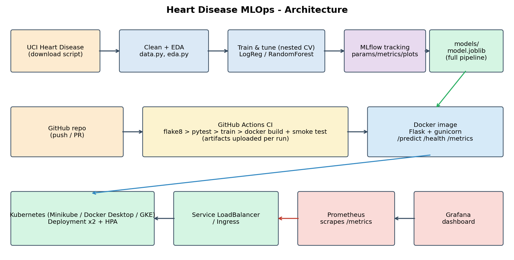

Flow: UCI data -> download/clean -> EDA and training (MLflow) -> versioned model artifact -> Docker image -> Kubernetes Deployment behind a LoadBalancer Service -> clients call `/predict`; Prometheus scrapes `/metrics`; Grafana visualises; GitHub Actions automates lint, test, train and image smoke test.

# 8. CI/CD pipeline

`.github/workflows/ci.yml` runs on every push to `main` and every pull request:

1. **lint-test:** `flake8`, then `pytest` with coverage and JUnit XML (uploaded as artifacts, even on failure).
2. **train** (needs lint-test): download data, generate EDA figures, train with MLflow, upload model, reports, `mlruns/` and the cleaned dataset.
3. **docker** (needs train): build the image, run it, poll `/health`, call `/predict` and `/metrics`, upload `smoke.json` and container logs.

Jobs are chained with `needs`, so any lint, test, or training error stops the pipeline with the failing command in the log (production-readiness requirement).

**Tests** (`tests/`, 18 tests): data cleaning (binarisation, duplicates, missing values kept, schema), preprocessing (no NaNs, scaling, unseen category, missing at inference), metrics, end-to-end training that writes artifacts, and API contract (valid prediction, missing field, out-of-range value, non-JSON body gives HTTP 400). Coverage is produced as `coverage.xml` in each run.

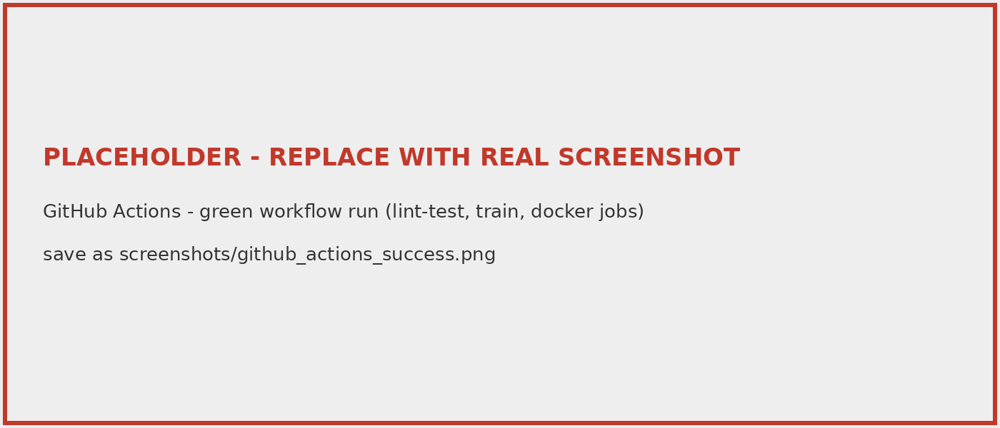

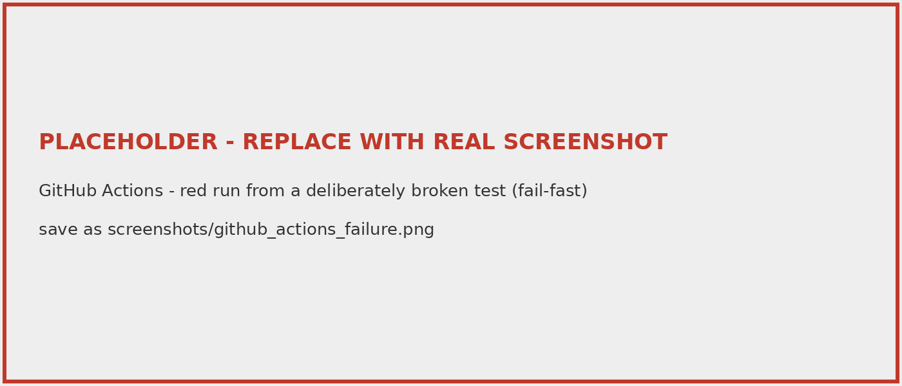

# 9. Containerisation and deployment

**API** (`api/app.py`, Flask + gunicorn): `POST /predict` accepts the 13 features as JSON, validates presence and ranges, and returns `prediction`, `label`, `confidence` and `probability_disease`. `GET /health` serves probes; `GET /metrics` serves Prometheus.

```json
{"confidence": 0.5762, "label": "no heart disease likely", "prediction": 0, "probability_disease": 0.4238}
```

**Docker.** `python:3.11-slim`, slim serving requirements only, non-root user, `HEALTHCHECK`, gunicorn with 2 workers and access log to stdout.

**Kubernetes** (`k8s/`): Deployment (2 replicas, readiness and liveness probes on `/health`, CPU/memory requests and limits), Service of type LoadBalancer, optional Ingress and HorizontalPodAutoscaler. Cluster used: `<Minikube / Docker Desktop / GKE>`. For a public cloud, push the image to a registry and change `image:` in `deployment.yaml`.

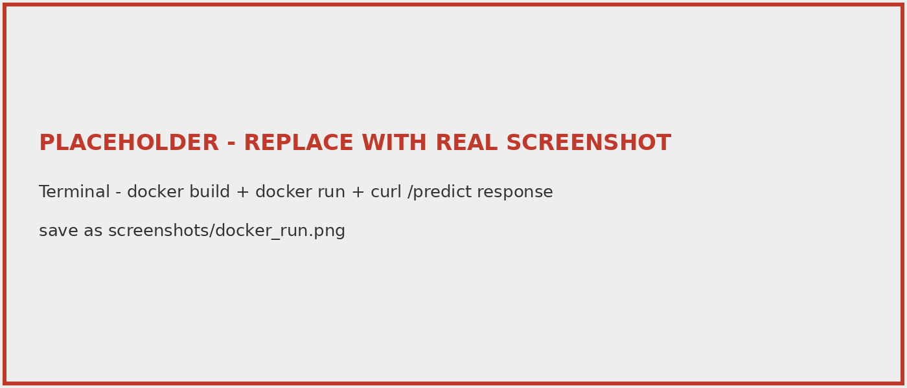

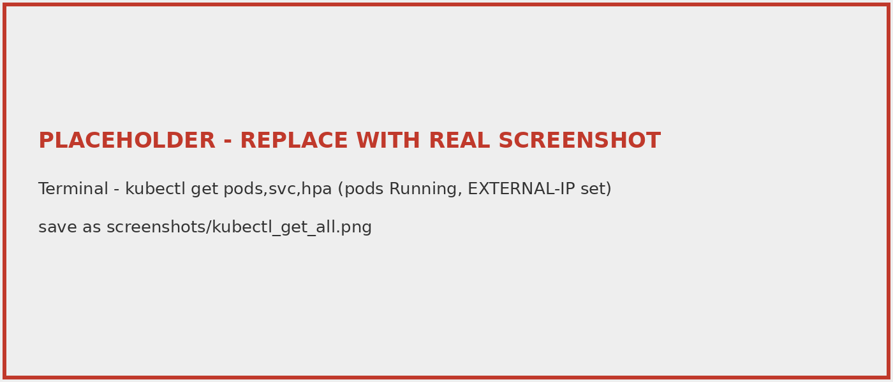

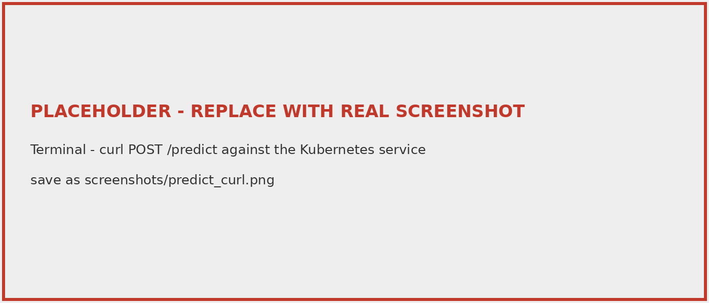

# 10. Monitoring and logging

**Logging.** Every request emits one JSON line (request id, method, path, status, latency ms); every prediction logs class and confidence; validation errors are logged with the reason. Logs are collected with `kubectl logs -l app=heart-api`.

**Metrics** (`api/metrics.py`, `/metrics`): request count by path and status, latency histogram, predictions by class, and 5xx count. Prometheus scrapes the pods (annotations in the Deployment; manifests in `k8s/monitoring.yaml`). The Grafana dashboard (`monitoring/grafana-dashboard.json`) shows request rate, p95 latency, predictions by class and error count. `scripts/load_test.py` generates traffic to populate it.

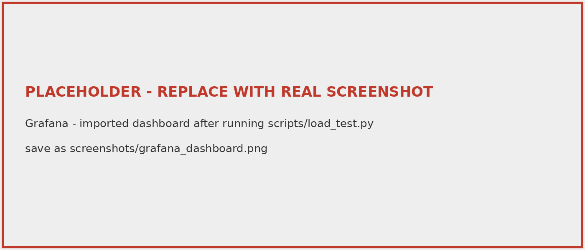

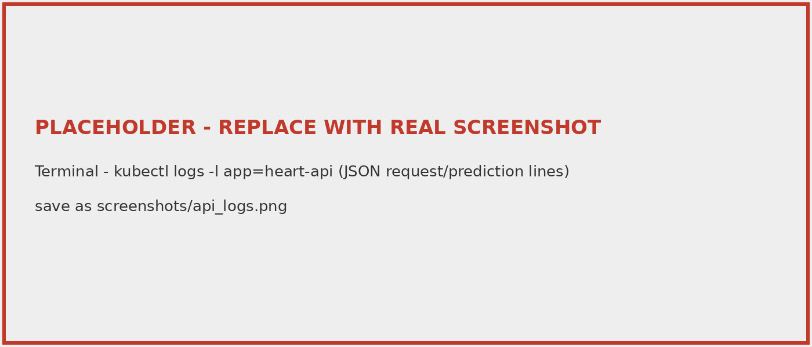

# 11. Limitations and future work

Only 303 patients from one hospital, so confidence intervals are wide and generalisation is unproven; the model is a teaching artifact, not a medical device. Future work: data and prediction drift monitoring, MLflow model registry with staged promotion, GitOps deployment (Argo CD), probability calibration, and threshold tuning to favour recall.

# 12. Links

Code: `<GitHub URL>` | Video: `<link>` | API: `<URL / access instructions>`
